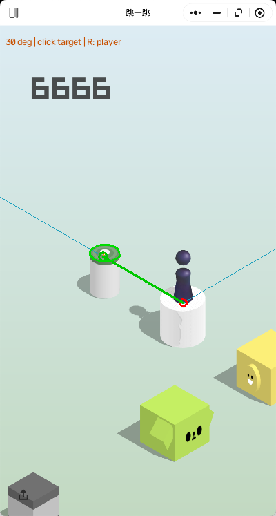

# WeChat Jump Helper

**A macOS automation project for WeChat's “Jump Jump” mini-game, powered by classical computer vision and native mouse input.**

This project automatically identifies the player and the next platform, calculates a projected landing point, and executes jumps through calibrated mouse presses.

After each jump, the system verifies scene stability and landing evidence before continuing. When recognition is uncertain, it **stops rather than guessing**.

Built with **Python, OpenCV, NumPy, and macOS Quartz**, without neural networks or external AI APIs.

> This is an unofficial personal engineering project and is not affiliated with WeChat or Tencent.

## Computer Vision Demo



*Actual output from the vision pipeline, showing detected platform boundaries, target selection, and projected landing-point geometry.*

## Features

- **Automated platform detection** — Combines edge detection, color segmentation, material analysis, shadow handling, and geometric constraints to recognize different platform shapes and appearances.
- **Geometric jump calculation** — Uses a configurable projection angle and calibrated distance-to-hold-time relationship.
- **Temporal tracking** — Analyzes consecutive screenshots, estimates camera movement, and verifies successful landings.
- **Safety-first automation** — Rejects ambiguous targets, stale screenshots, unstable scenes, and uncertain landing results.
- **Native macOS input** — Uses Quartz mouse events for controlled press-and-release actions.
- **Modular architecture** — Separates visual processing, geometric validation, aiming, tracking, and input control.

### Performance

In local gameplay testing, the program has achieved **100+ consecutive automated jumps**.

Performance depends on game appearance, window geometry, calibration, and recognition conditions. This result does not guarantee universal reliability.

## Requirements

- macOS
- Desktop WeChat with the Jump Jump mini-game
- Python 3.11 or newer recommended
- Screen Recording and Accessibility permissions
- A visible, unobstructed game window

Dependencies are listed in `requirements.txt`.

## Installation

Clone the repository:

```bash
git clone https://github.com/yypdylm/jump-helper.git
cd jump-helper
```

Create a Python virtual environment and install dependencies:

```bash
python3 -m venv .venv
source .venv/bin/activate
python -m pip install -r requirements.txt
```

Create a local `settings.json` file in the project directory:

```json
{
  "coefficient": 1700,
  "angle_degrees": 30,
  "auto_player": true,
  "screenshot_delay": 2,
  "focus_delay": 4
}
```

These values are examples from the original development environment. Calibration may need adjustment for other setups.

## Usage

First, launch the mini-game and position its window on your main display.

**Check the environment without sending mouse input:**

```bash
python jump.py --diagnose
```

**Preview recognition without executing jumps:**

```bash
python jump.py --auto --dry-run
```

**Start automatic gameplay:**

```bash
python jump.py --auto
```

During startup, move the mouse pointer to an empty area inside the game window and keep it stationary.

To stop automation, press **Esc**, move the mouse, or switch away from the game window.

Additional commands:

```bash
python jump.py --auto --max-jumps 3
python jump.py --auto --log-profile full
python jump.py --loop
```

You can also launch the program through `start-auto.command` after setting up the Python environment.

## How It Works

```text
Game Screenshot
       |
       v
Player & Platform Detection
       |
       v
Geometric and Material Validation
       |
       v
Target Selection & Landing Projection
       |
       v
Frame Stability Verification
       |
       v
Quartz Mouse Input
       |
       v
Camera Tracking & Landing Verification
       |
       +----> Next Jump / Safe Stop
```

### Computer Vision

The recognition pipeline uses several complementary techniques:

- Canny edge detection and contour analysis
- Color quantization and region segmentation
- Diamond and ellipse geometry validation
- Material, shadow, and occlusion analysis
- Multi-frame tracking and camera-motion estimation

The system evaluates detection methods in a defined order and applies shared geometric and material constraints.

Rather than selecting an arbitrary candidate when multiple plausible targets exist, the system conservatively refuses uncertain decisions.

### Jump Calculation

The aiming system models a jump using a fixed projection angle and normalized distance.

```text
hold_ms ≈ coefficient × projected_horizontal_distance / game_width
```

The calibration coefficient can be adjusted in `settings.json`.

## Project Structure

| Component | Purpose |
|---|---|
| `jump.py` | Main entry point and CLI |
| `auto_runner.py`, `auto_worker.py` | Automatic gameplay orchestration |
| `vision.py` | Main visual recognition pipeline |
| `vision_pixels.py`, `vision_geometry.py` | Shared pixel and geometric operations |
| `vision_validation.py` | Platform candidate validation |
| `vision_edges.py`, `vision_materials.py` | Edge and material recognition |
| `vision_small.py`, `vision_occlusion.py` | Small and partially occluded platforms |
| `vision_tracking.py`, `vision_landing.py` | Scene tracking and landing confirmation |
| `aiming.py` | Jump geometry and timing |
| `mac_input.py` | Native macOS mouse control |
| `capture_game.py` | Game window capture |
| `flight_recorder.py`, `log_store.py`, `data_manager.py` | Local diagnostics and data management |

## Development and Validation

The project was developed and evaluated using captured gameplay screenshots, regression tests, and real-game sessions.

The public repository contains the application source code and a representative visualization. Internal regression datasets, historical logs, and development-only test scripts are maintained separately and are not distributed here.

## Limitations

- Designed specifically for macOS.
- Recognition can fail with unfamiliar platforms, partial occlusion, unusual visual effects, or ambiguous scenes.
- Camera tracking and landing verification may occasionally stop automation even when a jump succeeds.
- Calibration may vary between window sizes and environments.
- The program does not automatically restart the game after failure.

The system prioritizes conservative decisions over uninterrupted gameplay.

## Acknowledgments

General implementation ideas were informed by:

- [wangshub/wechat_jump_game](https://github.com/wangshub/wechat_jump_game)
- [B5DX/pc_wechat_jump_auto](https://github.com/B5DX/pc_wechat_jump_auto)

This project implements its own macOS-specific recognition and input pipeline.

## Usage Rights

This repository is published as a personal engineering portfolio project.

No open-source license is currently granted. Rights to original source code and documentation are reserved by their respective authors. Third-party game artwork and branding remain the property of their respective rights holders.

---

[简体中文说明 / Chinese documentation](README.zh-CN.md)