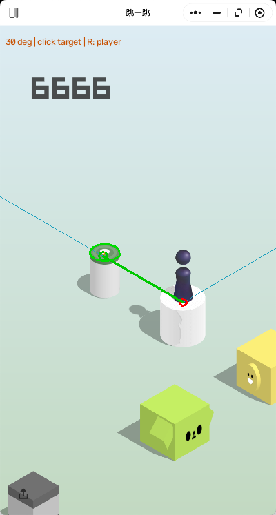

# 微信跳一跳自动辅助 — WeChat Jump Helper

**一个基于 Python、OpenCV 和 macOS 原生鼠标控制的微信「跳一跳」自动化项目。**

程序通过分析游戏窗口截图，自动识别棋子和下一目标平台，计算预计落点与鼠标长按时间，并执行跳跃。

每次跳跃后，系统会通过连续帧分析、相机位移估计和落地验证，判断是否可以安全继续。当识别结果存在歧义或缺乏可靠证据时，程序会**主动停止，而不是盲目跳跃**。

本项目使用**传统计算机视觉算法**，不依赖训练后的神经网络或外部 AI 识别 API。

> 本项目是非官方个人工程作品，与微信或腾讯没有关联。

[English Documentation](README.md)

## 计算机视觉识别示例



*程序实际生成的识别结果：通过 OpenCV 提取平台轮廓、确定下一跳目标，并利用几何投影计算预计落点。辅助线和标记用于展示自动决策过程。*

## 主要功能

- **自动平台识别：** 结合边缘检测、颜色分割、材质分析、阴影处理和几何约束，识别不同形状及外观的平台。
- **跳跃计算：** 根据目标距离、固定投影角度和标定系数计算鼠标长按时长。
- **连续帧追踪：** 通过图像特征匹配估计相机位移，验证棋子是否成功落在上一目标上。
- **安全停止机制：** 在目标不唯一、画面不稳定、识别过期或落地无法确认时拒绝发送跳跃。
- **macOS 原生输入：** 使用 Quartz 发送鼠标按下与释放事件。
- **模块化架构：** 将图像识别、几何验证、追踪、落点计算与输入控制分离。

### 实际表现

在本地游戏测试中，程序已实现 **连续自动跳跃 100 次以上**。

这一成绩来自特定环境下的实际运行，不代表所有关卡、游戏版本或设备都能获得相同表现。

## 运行环境

- macOS
- 微信桌面客户端及「跳一跳」小游戏
- 建议 Python 3.11 或更新版本
- 屏幕录制与辅助功能权限
- 完整、无遮挡的游戏窗口

依赖库见 `requirements.txt`。

## 安装

克隆 GitHub 仓库：

```bash
git clone https://github.com/yypdylm/jump-helper.git
cd jump-helper
```

创建 Python 虚拟环境并安装依赖：

```bash
python3 -m venv .venv
source .venv/bin/activate
python -m pip install -r requirements.txt
```

在项目根目录创建本地 `settings.json` 配置文件，例如：

```json
{
  "coefficient": 1700,
  "angle_degrees": 30,
  "auto_player": true,
  "screenshot_delay": 2,
  "focus_delay": 4
}
```

以上参数来自原开发环境。不同游戏窗口尺寸和设备可能需要重新标定。

`settings.json` 属于本地配置，已通过 `.gitignore` 排除，不会上传到 GitHub。

## 使用方法

启动微信「跳一跳」小游戏，确保窗口位于主显示器且没有遮挡。

**检查权限和窗口状态：**

```bash
python jump.py --diagnose
```

**只预览识别结果，不执行跳跃：**

```bash
python jump.py --auto --dry-run
```

**启动全自动模式：**

```bash
python jump.py --auto
```

其他选项：

```bash
python jump.py --auto --max-jumps 3
python jump.py --auto --log-profile full
python jump.py --loop
```

启动自动模式后，在倒计时内将游戏窗口置于前台，将鼠标移动到游戏内容区域的空白处，然后松开并保持静止。

**停止方式：** 按 Esc、移动鼠标或切换窗口。识别失败和落地验证不通过等情况也会触发自动停止。

完成环境配置后，也可以通过 `start-auto.command` 启动程序。

## 工作原理

```text
游戏窗口截图
      ↓
棋子与平台候选识别
      ↓
几何、材质及轮廓验证
      ↓
目标选择与落点投影
      ↓
连续帧稳定性检查
      ↓
Quartz 鼠标长按
      ↓
相机追踪与落地确认
      ↓
继续下一跳 / 安全停止
```

### 视觉识别

程序采用多种互补的传统计算机视觉方法：

- Canny 边缘检测与轮廓提取
- 颜色量化与连通区域分析
- 菱形和椭圆形状约束
- 材质、阴影及局部遮挡处理
- 多帧图像特征匹配与相机运动估计

不同检测方法按照预定顺序执行，并使用公共几何及材质验证逻辑。

当出现多个无法消歧的目标时，系统不会随意选择其中一个。

### 跳跃控制

跳跃时长由归一化距离和标定系数计算：

```text
长按时间 ≈ 标定系数 × 投影水平距离 / 游戏画面宽度
```

可以通过本地 `settings.json` 调整标定参数。

## 项目结构

| 文件 | 功能 |
|---|---|
| `jump.py` | 程序入口与命令行参数 |
| `auto_runner.py`、`auto_worker.py` | 自动运行流程 |
| `vision.py` | 视觉识别主流程 |
| `vision_pixels.py`、`vision_geometry.py` | 公共像素与几何计算 |
| `vision_validation.py` | 候选平台验证 |
| `vision_edges.py`、`vision_materials.py` | 边缘与材质识别 |
| `vision_small.py`、`vision_occlusion.py` | 小型平台与遮挡处理 |
| `vision_tracking.py`、`vision_landing.py` | 场景追踪与落地确认 |
| `aiming.py`、`mac_input.py` | 跳跃计算与原生鼠标控制 |
| `capture_game.py` | 游戏窗口截图 |
| `flight_recorder.py`、`log_store.py`、`data_manager.py` | 本地日志与数据管理 |

## 开发与验证

项目开发过程中使用了大量真实游戏截图、自动化回归测试及连续实机运行记录，以验证不同平台形状、材质和特殊视觉情况。

公开仓库主要保留运行所需的源代码、项目说明和视觉识别演示图。完整测试数据、历史日志和内部回归测试脚本不包含在公开版本中。

## 已知局限

- 仅针对 macOS 开发，尚未验证 Windows 或 Linux 兼容性。
- 特殊平台外观、局部遮挡、动态视觉效果可能导致识别失败。
- 相机追踪或落地确认偶尔可能在实际跳跃成功后仍触发安全停止。
- 不同设备和窗口尺寸可能需要重新标定。
- 程序不会在游戏失败后自动重开。

本项目优先保证决策可靠性，而非无条件连续运行。

## 参考项目

开发过程中参考了以下公开项目的基本思路：

- [wangshub/wechat_jump_game](https://github.com/wangshub/wechat_jump_game)
- [B5DX/pc_wechat_jump_auto](https://github.com/B5DX/pc_wechat_jump_auto)

本项目采用独立的 macOS 视觉识别与输入控制实现。

## 使用权利

本仓库作为个人工程作品公开展示，目前未授予开源许可证。

原创源代码与文档的权利由相应作者保留。游戏画面、美术素材及相关商标的权利属于各自权利人。

项目仅供个人研究与工程学习，请遵守相关平台规则。